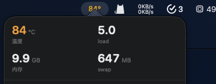

# Patrol（巡逻）

[English](README.md) · [简体中文](README.zh-CN.md)

一个常驻的 macOS 资源监测小工具。每 5 秒采一次进程级 CPU、内存、磁盘读写，每 30 秒采一次 CPU 温度、内存压力、swap 和负载；数据落进 SQLite 保留 7 天，有进程开始啃机器时弹一条普通的 macOS 通知。

起因很简单：一个 Node 进程连续几小时以 19 MB/s 往磁盘写，系统一声不吭。


*只读网页面板，`http://127.0.0.1:8787`，纯 HTML + canvas，无框架、无 CDN。*



*可选的菜单栏 App：显示当前 CPU 温度（白／78 °C 转橙／85 °C 转红），点开是一个小面板。*

## 采什么

| 指标 | 数据源 | 说明 |
|---|---|---|
| 进程 CPU、内存、磁盘读写 | `proc_pid_rusage`（flavor 6），经 `ctypes` | 不需要 root。CPU 时间单位是 mach absolute ticks，按固定 24 MHz 换算。 |
| 系统内存 | `vm_stat` | 已用 = active + wired + compressor，inactive 算缓存，跟 macOS 的内存压力口径一致。 |
| 磁盘吞吐 | `vm_stat` 的 pageins/pageouts 差分 | 没用 `iostat`：差分只要 3 ms，跟其余采样同量级，而且能区分读写。 |
| swap | `sysctl -n vm.swapusage` | |
| CPU 温度 | `smctemp`（Homebrew） | 多传感器取最大值。`powermetrics` 更准但要 root。 |
| 指定路径增长 | `os.walk` | 只统计大小，不读文件内容。 |

## 告警规则

| 规则 | 阈值 | 持续 | 级别 |
|---|---|---|---|
| `proc_cpu` | 单进程 ≥ 200% CPU | 3 次采样（约 15 秒） | warning |
| `disk_write` | 单进程 ≥ 5 MB/s | 3 次采样 | warning |
| `mem_pressure` | 关注进程组合计 ≥ 3 GB 内存 | 1 次 | warning |
| `temp_high` | CPU ≥ 90 °C | 12 次（约 1 分钟） | critical |
| `swap_high` | swap 已用 ≥ 1.5 GB | 1 次 | warning |
| `session_growth` | 指定路径 5 分钟内增长 ≥ 50 MB | — | warning |
| `load_high` | load1 ≥ 12 | 36 次（约 3 分钟） | warning |

同一规则对同一进程 10 分钟内只报一次。通知走 `osascript display notification`，不需要额外授权。

## 环境要求

| | |
|---|---|
| macOS | 14 及以上 |
| Python | 3.9+，只用标准库，不需要 `pip install` |
| [smctemp](https://github.com/narugit/smctemp) | `brew tap narugit/tap && brew install smctemp`，只有温度需要它，没有也能跑 |
| Xcode Command Line Tools | 只有菜单栏 App 需要（`swiftc`） |

## 安装

```bash
git clone https://github.com/Ryankiinovo/patrol.git
cd patrol
./bin/install.sh
open http://127.0.0.1:8787/
```

`install.sh` 会往 `~/Library/LaunchAgents/` 写三个 LaunchAgent——采集器、网页面板、菜单栏——都带 `RunAtLoad` 和 `KeepAlive`，登录自启、崩溃几秒内自动拉起。脚本是幂等的，拉新代码后重跑即可。

```bash
./bin/install-bar.sh      # 只重编重装菜单栏 App
./bin/uninstall-bar.sh    # 只关菜单栏，监测不受影响
./bin/uninstall.sh        # 全停，data/ 保留
```

## 配置

可调项都在 `monitor/collector.py` 顶部：

```python
SAMPLE_INTERVAL = 5         # 进程采样间隔（秒）
SYSTEM_INTERVAL = 30        # 温度/内存采样间隔（秒）
PROC_PERSIST_INTERVAL = 30  # 落库间隔（秒）
TOP_N = 12                  # 每次落库的进程数
KEEP_DAYS = 7               # 保留天数
ALERT_COOLDOWN = 600        # 单条规则冷却（秒）

WATCHED = [                 # (显示名, 路径关键字)
    ("DSH", ["DeepSeek Harness"]),
    ...
]
WATCH_PATHS = [...]         # 需要盯总大小的目录或文件
COMPANIONS = (...)          # 上面哪些进程参与内存合计告警
```

默认值指向我自己的工具链（DeepSeek Harness、一个日志文件、一个会话目录）。换成你想盯的东西就行；这两个列表留空也能正常工作，只是少了路径增长这条告警。

阈值硬编码在 `Monitor.evaluate()` 里，就是几个整数，好改。

## HTTP 接口

面板只读，绑在回环地址（`127.0.0.1`）；换端口设 `PATROL_PORT`，`install.sh` 与 `install-bar.sh` 会把它一并写进 launchd 任务，菜单栏跟着走。所有接口返回 JSON：

| 接口 | 返回 |
|---|---|
| `/api/overview` | 最新样本、最近一批进程 |
| `/api/series?seconds=3600` | 面板折线用的时间序列 |
| `/api/procs` | 最近的进程行 |
| `/api/writers` | 最新一批里写盘最多的进程 |
| `/api/paths` | 指定路径的大小 |
| `/api/alerts` | 最近告警 |

## 开销

MacBook Air M2 实测，运行 18 分钟后：

| | |
|---|---|
| CPU | 采集器 0.0%，网页面板 0.0%，菜单栏 0.0–0.7% |
| 内存 | 采集器约 20 MB，面板约 20 MB，菜单栏约 75 MB |
| 数据库增长 | 约 6 MB/天；保留 7 天，稳定在 50 MB 左右 |
| 磁盘写入 | 约 150 MB/天（含 SQLite WAL 往返） |
| 日志 | 约 11 KB/天——只在规则触发时写一行 |

## 已知限制

- 只支持 macOS。采集器建立在 libproc、`vm_stat` 和 `smctemp` 上。
- CPU 时间按 24 MHz 的 mach timebase 换算。Apple Silicon 上成立；换别的硬件百分比会差一个常数倍——`monitor/system.py` 里已经读了真实 timebase，需要可移植时把 `ticks_to_seconds` 切过去即可。
- 能耗（mW）恒为 0：`proc_pid_rusage` 这个字段非 root 下返回 0。
- 网页面板没有鉴权，只绑回环，请不要对外暴露。
- 它不是进程管理器：只负责发现，不负责杀。

## 目录

```text
monitor/     采集器、libproc 绑定、系统指标、SQLite 存储
web/         只读 HTTP 面板（一个 Python 文件 + 一个 HTML 页面）
src/menubar/ SwiftUI 菜单栏 App 及其构建脚本
bin/         安装／卸载脚本与 LaunchAgent 模板
data/  logs/ 运行时状态（已 git-ignore）
```

## 许可证

MIT。
